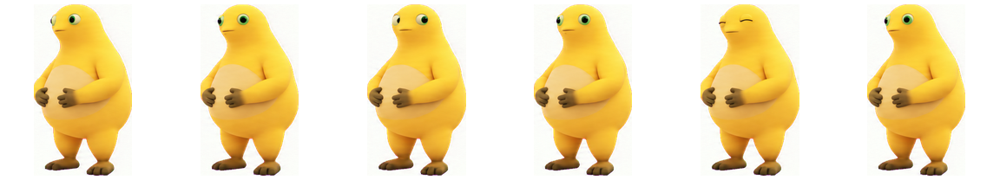
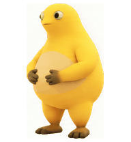

# 奶蛙 · Naiwa Pet

[简体中文](./README.md) · [English](./README.en.md)

这是一个非官方的 ChatGPT 自定义宠物素材包，包含奶蛙的 v2 动画精灵图，以及左右看和捧腹大笑动作预览。素材取自当前宠物图集，预览没有重新绘制角色。

[下载完整素材包](https://github.com/victkk11-beep/naiwa-pet-download/raw/refs/heads/main/naiwa-pet-download.zip) · [下载 v2 精灵图](https://github.com/victkk11-beep/naiwa-pet-download/raw/refs/heads/main/naiwa-pet-spritesheet-v2.png)

## 奶家人快来支持！！！

如果你也喜欢奶蛙，欢迎给仓库点亮 ⭐ Star、分享给其他奶家人，也欢迎提出想看的动作建议！

## 动作预览

**待机：左右看与眨眼**

**悬停：捧腹大笑**

以上预览直接由当前 v2 精灵图对应的动画行导出。当前宠物图集为透明 PNG，1536 × 2288 像素，8 列 × 11 行，单格 192 × 208 像素。

## 下载与使用

1. 下载上方 ZIP 并解压，或单独下载 `naiwa-pet-spritesheet-v2.png`。
2. 在 ChatGPT 桌面应用打开 **Settings → Pets → Create pet**。应用会打开创建宠物的新对话。
3. 在新对话中附上 PNG，并说明：**“请将这张 v2 精灵图作为奶蛙宠物使用，保留图集像素，不要重新绘制角色。”**
4. 创建完成后回到 **Settings → Pets**，选择 **Refresh**，再选择奶蛙。

详细入口请看 [ChatGPT 官方宠物说明](https://learn.chatgpt.com/docs/pets)。本仓库提供的是 v2 图集；网页端的 **Upload pet** 当前要求 1536 × 1872 像素图集，因此请使用桌面应用的 **Create pet** 流程。

## 文件

- `naiwa-pet-spritesheet-v2.png`：创建宠物所用的完整透明 v2 图集。
- `naiwa-pet-download.zip`：图集、双语说明和动作预览的打包文件。
- `laugh-preview.gif`：捧腹大笑循环。
- `assets/idle-look.gif`、`assets/hover-laugh.gif`：从当前图集导出的动作循环。
- `assets/*-frames.png`：对应动作的逐帧预览。

## 常见问题

**这个宠物有大笑声音吗？**

素材包不含音频，动画预览也是静音的。

**为什么网页上传不接受这张图？**

本图集是 v2（1536 × 2288）。官方宠物说明中的网页上传规格为 1536 × 1872；请在 ChatGPT 桌面应用使用 Create pet 流程。

## 归属说明

这是基于用户提供视觉参考制作的非官方粉丝作品，与奶蛙/Naiwa 应用或其发行方无关联，也未获其背书。角色及相关标识的权利归各自权利人所有。本仓库不主张角色版权或商标权，也不授予底层角色素材的使用许可。需要再分发、商业使用或其他需授权的用途时，请先联系权利人。
